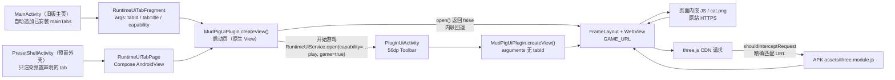

# 泥猪洗 · hita-plugin-mudpig

OH-MY-HITA 运行时界面插件（UI plugin），ID `com.kajimi.hita.ui.mudpig`，显示名 **泥猪洗**。

安装后，宿主两种外壳的行为不同：

- **MainActivity（旧版主页，`MainActivity.kt:695-709`）**：把已安装插件的 `mainTabs` 自动追加到底部导航，因此会出现「泥猪洗」标签。
- **PresetShellActivity（预置外壳，`PresetShellActivity.kt:255-317` → `loadShellTabs`）**：只渲染**当前预置声明**的 tabs；`UiPluginManager.mainTabs()`
  在这里只是查找池，不会自动追加。安装本插件**不会**让标签自动出现在预置外壳中——请用
  **功能中心 → 已安装插件**（或外壳抽屉卡片）直接打开 `PluginUiActivity`，或让预置声明
  `com.kajimi.hita.ui.mudpig`。

标签页先显示一个原生 View 启动页（玩法说明 +
开始按钮 + 原站链接 + 授权声明），点击「开始游戏」后通过宿主的
`RuntimeUiService.open()` 打开 `PluginUiActivity`，其中内嵌 WebView 加载原站游戏
[泥んこ豚洗い（Muddy Pig Wash）](https://keifurukawafunnych.com/games/mud-pig-wash/)。
若宿主路由不可用，启动页会把内联 WebView 装进标签页（代码路径已审查；0.10.4 宿主 E2E
走的是正常路由，回退分支未在真机强制触发）。

本插件**不复制、不镜像**游戏页面、`cat.png` 或站点图标；只加载原站 URL。唯一内置的第三方代码是
MIT 许可的 three.js r160（用于在 CDN 不可达时从 APK 本地提供），详见
[THIRD_PARTY_NOTICES.md](THIRD_PARTY_NOTICES.md)。

## 架构



要点：

- 启动页、错误页、归属条全部由代码构建原生 View，不使用 Compose，不使用 XML 资源，
  `plugin.json` 的 `composeVersion` 仍按宿主校验要求写 `1.9.4`。
- WebView 是内联 `FrameLayout` 的直接子 View，便于宿主/测试逐层查找。
- 自定义 `WebView` 在 `ACTION_DOWN` / `ACTION_POINTER_DOWN` 时调用
  `parent?.requestDisallowInterceptTouchEvent(true)`，避免宿主 ViewPager 抢走拖动/缩放手势。
- three.js 请求（`https://cdn.jsdelivr.net/npm/three@0.160.0/build/three.module.js`）由
  `shouldInterceptRequest` 从插件 APK 的 `assets/three.module.js` 返回；找不到资源时返回
  `null`，回退到网络。读取结果线程安全缓存。

### 已验证（0.10.4 实测）

- 宿主 0.10.4 debug 构建（`HITA_API_VERSION=13`、Compose 运行时 1.9.4）；插件
  `market/mudpig-0.1.0.apk`，**357,183 B**，sha256
  `e7cb3cb70480d036d566c17e7a7cee5285dfd0c884241c468e72bec77be1781b`
  （设备上 `files/ui-plugins/com.kajimi.hita.ui.mudpig/plugin.apk` 为同一 hash）。
- **MainActivity 路径**：底部「泥猪洗」tab → 启动页 → 开始游戏 → `PluginUiActivity` 游戏页；
  logcat 可见 `START ... PluginUiActivity`、`serve local three.js 1272972 bytes`、
  `onPageFinished https://keifurukawafunnych.com/games/mud-pig-wash/`。
- **PresetShellActivity 路径**：启动页（插件 View）由 `RuntimeUiTabPage` + Compose
  `AndroidView` 承载；点「开始游戏」后打开 `PluginUiActivity` 游戏页，**不是内联回退**
  （游戏截图有 56dp `PluginUiActivity` 工具栏、无 dock，`START` 日志确认）。
- 该路径使用了 seeded `preset_state.xml` 测试夹具：当前随包/在线预置都没有声明本插件 tab
  （`PresetShellActivity.loadShellTabs` 只映射预置声明的 tab，`UiPluginManager.mainTabs()`
  只是查找池），夹具只补上「声明 tab + 选中 Compose 外壳」；用于选中外壳的
  `preset_state` 手工写入技术与仓库 `docs/evidence/7.1/2026-11-22/lite-port.md` 相同。
  外壳、tab 映射、`RuntimeUiTabPage`、`AndroidView` 均为真实宿主路径。
- `RuntimeUiTabPage` 的 `$arguments` getter 经 dexdump 确认返回捕获字段，**无递归**。

## 已验证的宿主契约（本地 0.10.4 E2E + 宿主源码）

以下事实来自对 0.10.4 宿主的本地 E2E 验证与源码审阅，行号指
[oh-my-hita-standalone](https://github.com/oh-my-hita/oh-my-hita-standalone) 对应源码。
注意：构建期依赖 `plugin-sdk:11.1` 是 SDK artifact 版本号，与宿主
`HITA_API_VERSION=13` 是两套编号，不可混用。

| 事实 | 证据 |
| --- | --- |
| `ComposeUiPlugin` 只有 `id` / `displayName` / `requiresApi` / `createView(context, host)` / `onDestroy()`；`createView` 可返回任意 `View` | `api/src/main/java/com/stupidtree/hita/api/ComposeUiPlugin.kt:73-88` |
| `PluginUiHost` 仅暴露 `service(ServiceKey)`、`arguments: Bundle`、`close()` | `ComposeUiPlugin.kt:91-99` |
| `RuntimeUiService.KEY = ServiceKey<RuntimeUiService>("hita.runtime.ui")`；`open(context, capability, arguments)` 把 capability 解析为已启用插件的任意声明字符串，并原样转发 arguments | `api/.../RuntimeUiService.kt:22-42`；实现 `app/.../HApplication.kt:234-266` |
| capability → 插件解析不去重、无白名单：`enabled().firstOrNull { capability in it.capabilities }` | `app/.../uiplugin/UiPluginManager.kt:89-90` |
| 宿主不会给 `PluginUiHost.arguments` 注入 capability；只有主标签路径由宿主注入 `tabId` / `tabTitle` / `capability` | `PluginUiActivity.kt:91-95,101`；`RuntimeUiTabFragment.kt:39-41` |
| `PluginUiActivity` = 垂直 `LinearLayout`：56dp `Toolbar` + 内容；无 `onBackPressed`、无沉浸式/全屏、无 `configChanges` | `PluginUiActivity.kt:51,70-81` |
| 安装时校验 `plugin.json`；`mainTabs[].iconAsset` 从插件 APK 的 `assets/` 用 `ZipFile` 读取 | `UiPluginManager.kt:62-73,279-313` |
| 宿主 0.10.4：`HITA_API_VERSION=13`、Compose 运行时 1.9.4；本插件声明 `apiVersion`/`requiresApi=11`（≤13，故被接受）；`composeVersion` 必须等于 `1.9.4` | `oh-my-hita-standalone/api/src/main/java/com/stupidtree/hita/api/Plugin.kt`（`const val HITA_API_VERSION = 13`）；`oh-my-hita-standalone/build.gradle`（`compose_version = '1.9.4'`） |
| 宿主自带 WebView；无 `androidx.webkit` 依赖 | 本地 0.10.4 E2E 与宿主 `app/build.gradle` 依赖清单 |

## 构建与发布

环境：JDK 17+、Android SDK Platform 36（AGP 8.6.1 / Kotlin 2.2.21 / Gradle 8.7）。
`local.properties` 中写入本机 SDK 路径。

```bash
# 仅构建 APK
./gradlew --no-daemon :ui-plugin:assembleDebug

# 构建并生成 market/
./gradlew --no-daemon publishMarket

# 可选：离线覆盖 SDK 仓库（默认使用官方 raw-GitHub SDK 仓库）
./gradlew --no-daemon publishMarket \
  -PpluginSdkRepo=file:///path/to/plugin-sdk/maven
```

产物：

- APK：`ui-plugin/build/outputs/apk/debug/ui-plugin-debug.apk`
- 市场：`market/mudpig-0.1.0.apk` + `market/index.json`（含 `sha256` / `size` / `minHostApi` /
  `mainTabs`）。`id` 与 `version` 在根 `build.gradle` 常量中定义，`publishMarket` 会校验 APK 内
  `assets/plugin.json` 与常量一致，防止漂移。

## 安装到已有宿主（不发布）

### 自定义插件源（release 宿主 0.10.4）

1. 把整个 `market/` 目录部署到任意 HTTP(S) 静态站点，确保 `index.json` 可访问。
2. 宿主中打开：**插件市场 → 插件源 → 添加插件源**，填写索引地址
   `https://<你的站点>/market/index.json`。`index.json` 里的 `url` 是相对路径
   `mudpig-0.1.0.apk`，会相对索引地址解析到同目录的 APK，因此必须连同 APK 一起托管。
3. 安装后走 **功能中心 → 已安装插件 → 泥猪洗**：直接打开 `PluginUiActivity`（无 `tabId`，进入游戏），这是最可靠的入口。底部「泥猪洗」标签只在旧版 `MainActivity` 外壳（未选择预置）自动出现；预置外壳（`PresetShellActivity`）只渲染预置声明的 tab，需让预置声明 `com.kajimi.hita.ui.mudpig`。

已发布的宿主 0.10.4 本身支持自定义插件源，**无需重新构建宿主**。

### adb 调试安装（仅 debuggable 宿主）

`DevUiPluginInstallerReceiver` / `DevUiPluginOpenReceiver` 位于宿主的
`app/src/debug/java/com/stupidtree/hitax/uiplugin/`，**只有 debug 构建包含**；release 包没有
这两个组件，下面的命令在 release 宿主上不会生效。

```bash
PKG=io.github.kajimi16.ohmyhita
APK=ui-plugin/build/outputs/apk/debug/ui-plugin-debug.apk
SHA=$(sha256sum "$APK" | cut -d' ' -f1)

adb push "$APK" /data/local/tmp/dev-ui-plugin.apk
adb shell run-as "$PKG" cp /data/local/tmp/dev-ui-plugin.apk \
  /data/user/0/$PKG/files/dev-ui-plugin.apk

adb shell am broadcast \
  -a com.stupidtree.hitax.DEV_INSTALL_UI_PLUGIN \
  -n "$PKG/com.stupidtree.hitax.uiplugin.DevUiPluginInstallerReceiver" \
  --es path "/data/user/0/$PKG/files/dev-ui-plugin.apk" \
  --es sha256 "$SHA"

# 可选：跳过导航直接打开插件（无 tabId，直接显示内联游戏）
adb shell am broadcast \
  -a com.stupidtree.hitax.DEV_OPEN_UI_PLUGIN \
  -n "$PKG/com.stupidtree.hitax.uiplugin.DevUiPluginOpenReceiver" \
  --es id com.kajimi.hita.ui.mudpig
```

安装结果由宿主日志标签 `DevUiPlugin` 输出（`adb logcat -s DevUiPlugin:*`）。安装成功后走
**功能中心 → 已安装插件 → 泥猪洗** 进入（`PluginUiActivity`，无 `tabId` → 游戏）。底部「泥猪洗」
标签只在旧版 `MainActivity` 外壳（未选择预置）自动出现；预置外壳需让预置声明
`com.kajimi.hita.ui.mudpig`。

## 发布到 oh-my-hita 官方市场

- 仓库：<https://github.com/oh-my-hita/ui-mudpig>
- 发布：<https://github.com/oh-my-hita/ui-mudpig/releases/tag/v0.1.0>
  （`mudpig-0.1.0.apk`，357,183 B，sha256 `e7cb3cb70480d036d566c17e7a7cee5285dfd0c884241c468e72bec77be1781b`）

1. 本目录已在 <https://github.com/oh-my-hita/ui-mudpig> 以 MIT 许可（`LICENSE`）发布。
2. 发版时同时修改根 `build.gradle` 的 `mudpigVersion` 与
   `ui-plugin/src/main/assets/plugin.json` 的 `version`；`publishMarket` 会校验两者一致，不一致直接失败。
3. push 后在 <https://github.com/oh-my-hita/registry> 提交发布请求，包含：
   - repo URL、ref
   - module `:ui-plugin`、kind `ui`
   - plugin_id `com.kajimi.hita.ui.mudpig`
   - name `泥猪洗`、version `0.1.0`
   - entry_class `com.kajimi.hita.ui.mudpig.MudPigUiPlugin`
   - min_host_api `11`
   - tags `game,webview,webgame`
4. CI 负责构建 APK、校验 `assets/plugin.json`、计算 sha256，并写入 `dist/` 与 registry。
5. 全程无需向宿主提交 PR；后续更新只需 bump 版本并重复发布请求。

## 游戏分析

| 项目 | 结论 |
| --- | --- |
| 引擎 | 手写 three.js r160（WebGL），全部游戏逻辑内联在单个静态 HTML 中 |
| 原站首次传输 | 页面 42.6 KB gzip + three.js 200.9 KB gzip + `cat.png` 113 KB ≈ 357 KB |
| 本插件首次传输 | 网络 = 页面 42.6 KB gzip + `cat.png` 113 KB ≈ 156 KB；three.js 由 APK 本地提供（`1,272,972` B 原始，APK 内约 201 KB 压缩） |
| 广告/分析 | 原站 `ad.js` / `gtag` 另约 188 KB gzip，非游戏必需；插件不拦截 |
| 服务端 | 无游戏 API；仅静态托管 + three.js CDN；AdSense/GA 为可选项 |
| 音频 | 全部 Web Audio 合成，无音频文件 |
| 输入 | 单指冲水、双指转视角、双指捏合缩放；无键盘/全屏 API |
| 授权 | 游戏/文章/图片版权归作者（ふるかわけい）；仅明确允许游玩、录像/直播、截图、分享链接；**不镜像、不复制资源** |
| three.js | r160，MIT，允许随插件分发（本插件内置） |

内置 `assets/three.module.js` 字节数 `1,272,972`，SHA-256：
`76dea8151bc9352aef3528b4262e249b2604f62543828328db978d060d61a495`。

## 启动页行为

- 标题 `泥猪洗` / `泥んこ豚洗い`，一句说明与三条操作提示。
- 「开始游戏」→ `host.service(RuntimeUiService.KEY)?.open(context, "com.kajimi.hita.ui.mudpig.play", Bundle { game = true })`；
  返回 `false`/`null` 时把内联 WebView 装进启动页容器（不依赖宿主路由）。
- 「在浏览器中打开原站」与归属条点击均用 `Intent.ACTION_VIEW` 打开原站。
- 主题色通过 `context.theme.resolveAttribute()` 读取
  `colorBackground` / `textColorPrimary` / `textColorSecondary` / `colorAccent`，逐项有安全回退值。

## 局限与注意事项

- **需要联网**：本插件只本地提供 three.js；游戏 HTML 与 `cat.png` 仍从原站加载。
- 游戏结果页可能出现**原站自己的 AdSense 广告**，本插件不注入、不修改页面。
- **旋转屏幕会重建** `PluginUiActivity`（宿主未声明 `configChanges`），WebView 与游戏进度丢失。
- `PluginUiActivity` 固定 56dp 工具栏，**无沉浸式/全屏**；硬件返回键直接结束插件页面，
  WebView 收不到返回事件。主标签页还受宿主 64dp 顶栏/底栏约束。
- WebView 内可能无法使用 `navigator.share` / 下载结果图（未接 `DownloadListener`）。
- 仅拦截精确的 three.js URL；上游若更换版本或 CDN，会自动回退到网络加载。
- 页面自身在第一次触摸时解锁音频；本插件设置了 `mediaPlaybackRequiresUserGesture=false`。
- 稳定性依赖宿主实现：插件失败时宿主会禁用插件（`PluginUiActivity.kt:82-88`）。
- **宿主只向 UI 插件转发 `onDestroy`**（`ComposeUiPlugin` 无 `onPause`/`onResume`/`onStop`，
  `PluginUiActivity` 也只覆写 `onDestroy`），它不会代为管理 WebView 生命周期。因此整个 App 进入后台时，
  页面的 `requestAnimationFrame`/Web Audio 可能短暂继续运行，回到前台后继续；只有离开插件页面才通过
  `onDestroy` → WebView `destroy()` 释放。这是宿主契约限制而非插件缺陷；未来插件版本可自行用
  `onWindowVisibilityChanged` 暂停/恢复。

## 目录

```
hita-plugin-mudpig/
├── build.gradle                  # Kotlin/AGP 版本、publishMarket、id/version 常量
├── settings.gradle               # google / mavenCentral / pluginSdkRepo
├── gradle/wrapper/               # Gradle 8.7
├── market/                       # publishMarket 产物
└── ui-plugin/
    ├── build.gradle
    └── src/main/
        ├── AndroidManifest.xml   # 空 application，无组件/权限
        ├── assets/
        │   ├── plugin.json
        │   ├── tab_mudpig.png    # 96×96 纯代码生成的猪鼻图标
        │   └── three.module.js   # three.js r160（MIT）
        └── java/com/kajimi/hita/ui/mudpig/
            ├── MudPigUiPlugin.kt # 入口、启动页、主题色
            ├── MudPigGameView.kt # WebView、客户端、错误页、归属条
            └── PluginAssets.kt   # 从自身 APK 读 assets
```

## 归属

- 游戏 **泥んこ豚洗い** © ふるかわけい / <https://keifurukawafunnych.com/games/mud-pig-wash/>
- 本插件仅嵌入原站，不复制游戏资源。游戏内出现的广告、分析脚本均属于原站。
- three.js © 2010-2024 three.js authors，MIT License（见 `THIRD_PARTY_NOTICES.md`）。
